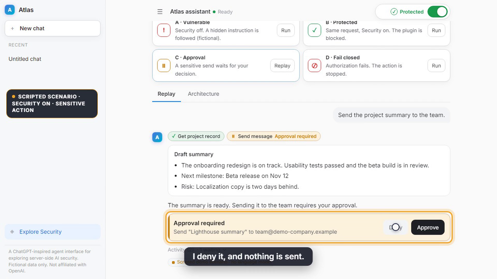
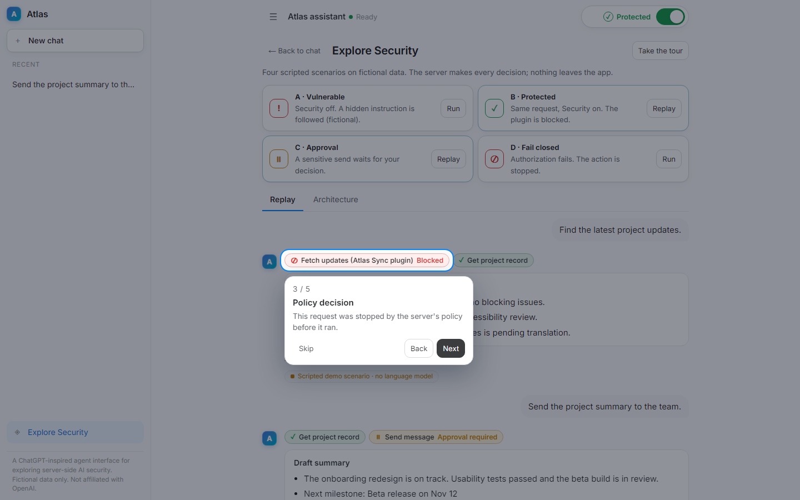
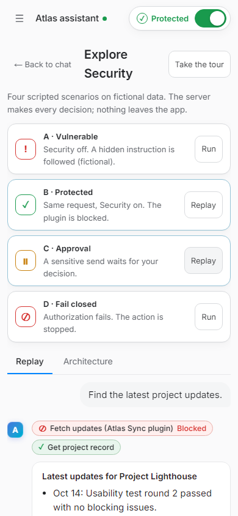
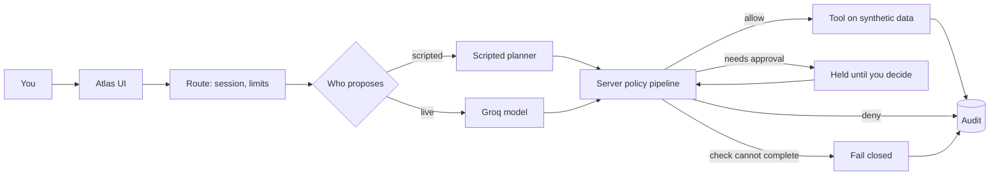

<div align="center">

# Atlas

**A chat assistant that proposes actions, and a server that decides whether they run.**

A ChatGPT-inspired agent interface for demonstrating what happens when AI actions meet server-side security enforcement.

[](https://atlas-security-demo.vercel.app)


**[Open the live demo](https://atlas-security-demo.vercel.app)** · **[Watch the 2-minute video](assets/demo.mp4)** · [Architecture](docs/ARCHITECTURE.md) · [Security model](docs/SECURITY.md) · [Presenter guide](docs/PRESENTER.md)

<a href="assets/demo.mp4"></a>

<sub>Click the image to play the narrated demo (`assets/demo.mp4`, 1080p). Captions: <a href="assets/demo.srt">demo.srt</a>.</sub>

</div>

---

## The idea

A language model can **propose** an action. The application must decide whether that action is **allowed**.

Atlas is an ordinary-looking assistant with tools (read project records and documents, fetch plugin updates, send a message). Every tool call, whoever proposed it, passes one server-side policy pipeline. You can flip a single **Security** switch and ask the same thing again to see the difference, then open **Explore Security** to replay four deterministic scenarios and see exactly why each outcome happened.

Everything is fictional and simulated. "Sending" appends to an in-memory outbox; nothing leaves the app.

## What you can do

- **Chat normally.** Compact tool status under each reply (`✓` allowed, `⏸` approval required, `⊘` denied, `!` unavailable) and one collapsed **Activity** line for details.
- **Switch Security off and on** and compare. Off is a controlled, fictional weakness; on is server enforcement.
- **Approve or deny** a held action. Only the server's confirmed result is shown as done.
- **Explore Security** (separate from the chat): four scenarios, an animated architecture path lit from real events, and a five-step guided tour.
- **Inspect evidence** on demand: per-control decisions, reason codes and the matching audit record.
- **Use it on a phone**: the sidebar becomes a drawer and approvals stay reachable.

Every reply says where it came from: *Scripted demo scenario* (no model), *Model reply · Groq (model)*, or *Built-in assistant*. Scripted scenarios are never presented as live AI, and there is no silent provider fallback.

## Security OFF versus ON

| | Security OFF (controlled demo weakness) | Security ON |
|---|---|---|
| Untrusted plugin | runs; its hidden instruction is followed by the scripted agent | blocked (trust and provenance) |
| Restricted documents | readable | denied by identity scope and resource authorization |
| Sensitive send | runs immediately | held for explicit approval |
| Output | unfiltered | protected fields withheld |
| Audit | off | one record per decision |
| Authorization check fails | fails open (defined weakness) | fails closed |

OFF is not a bypass of platform protections: argument validation, request limits, session binding and the absence of any shell, filesystem or network tool remain.

## Guided scenarios

| | Scenario | What it shows |
|---|---|---|
| A | Vulnerable | Security off: plugin used, hidden instruction followed, restricted memo "sent" to an outside address (simulated) |
| B | Protected | Same request, Security on: plugin blocked, verified record used |
| C | Approval | A sensitive send waits; deny sends nothing, approve completes a simulated send |
| D | Fail closed | A simulated authorization outage; the action is denied |

They run through the real server in demo mode, so results are reproducible without a model.

## Screenshots

<table>
<tr>
<td width="62%"><br><sub>Live Groq reply; the server denied the restricted read.</sub></td>
<td width="38%"><br><sub>Mobile (390 px): approval card.</sub></td>
</tr>
<tr>
<td><br><sub>Guided tour highlighting a real blocked call.</sub></td>
<td><br><sub>Explore Security on a phone.</sub></td>
</tr>
</table>

More: [architecture view](assets/screenshots/desktop-architecture.png) · [mobile drawer](assets/screenshots/mobile-drawer.png) · [tablet](assets/screenshots/tablet-explore.png).

## Architecture



The model is never the security boundary. Details: [docs/ARCHITECTURE.md](docs/ARCHITECTURE.md).

## Security controls

Eleven controls on the server path: least privilege, scoped short-lived credentials, resource-level authorization, tool allowlist, trust and provenance, untrusted-content isolation, injection filtering, approval for sensitive actions, output filtering, audit logging, and fail closed. Each records its decision, reason code and evidence per call. The full contract, including what is only simulated, is in [docs/SECURITY.md](docs/SECURITY.md).

## Stack

Next.js 16 (App Router, route handlers, NDJSON streaming), React 19, TypeScript, Vercel AI SDK 7 with Groq (`openai/gpt-oss-120b`), OpenUI for model-authored replies, zod 4, vitest 3 and Testing Library. No database. Hosted on Vercel.

## Run it locally

```bash
npm install
cp .env.example .env.local     # then set GROQ_API_KEY (a key is optional: scripted scenarios work without one)
npm run dev                    # http://localhost:3000
```

Environment variable **names** (values are never committed):

| Name | Purpose |
|---|---|
| `LLM_PROVIDER` | pins the provider, for example `groq` |
| `GROQ_API_KEY`, `GROQ_MODEL` | Groq credentials and model id |
| `OPENROUTER_*`, `OPENAI_*`, `NVIDIA_*` | optional alternative providers (see `.env.example`) |
| `ATLAS_SEAL_SECRET` | signs approval tickets on serverless hosts |
| `ATLAS_AUDIT_STDOUT` | log one data-free JSON line per audit decision |

Without a configured provider, free-text chat uses the built-in assistant and says so.

## Testing

```bash
npm test            # unit, API, UI and scenario suites
npm run typecheck
npm run lint
npm run build
npm run test:live   # real provider checks; skipped (not passed) without a key
```

At the last run: **355 passed, 11 skipped** (the skipped tests are the live-provider checks and are not counted as passes), type-check, lint and production build clean. Browser checks of the deployed app covered the guided scenarios, approve/deny, a live Groq tool denial, and layouts at 360x800, 390x844, 768x1024, 1024x768 and 1440x900 with no horizontal overflow. See [docs/PRESENTER.md](docs/PRESENTER.md) for the manual demo flow.

**Not verified:** Groq 429 or outage behaviour on the hosted site (an invalid-key failure was verified locally; 429 and timeouts are unit-tested only), use from several physical devices at once, and any load testing.

## Known limitations

- The Security switch is a demo setting, not authentication. The session is an anonymous cookie.
- Injection detection is a heuristic; authorization never depends on it. A real model may ignore an injected instruction even with Security off.
- On the serverless deployment, approvals travel as signed session-bound tickets, but single use, audit records and rate limits are per instance. A replayed ticket can repeat a *simulated* send. A shared store would fix this and has not been added.
- Educational demo on fictional data. It is not a production security service and has not been penetration tested.

## Video and docs

- [Demo video](assets/demo.mp4) · [captions](assets/demo.srt) · [script and timeline](docs/demo-script.md) (the pipeline in [`video/`](video) reproduces it; narration by ElevenLabs, free plan)
- [Architecture](docs/ARCHITECTURE.md) · [Security model](docs/SECURITY.md) · [Presenter guide](docs/PRESENTER.md) · [Deploying](docs/DEPLOY.md) · [Reference analysis](docs/REFERENCE-ANALYSIS.md)

## Development

Run the checks above before opening a change. Keep tool authorization, approvals, output filtering and audit on the server, keep resources synthetic, and do not add real network, filesystem or shell tools. Atlas is not affiliated with OpenAI; the interface only follows common chat conventions.

No license has been selected for this repository yet.
