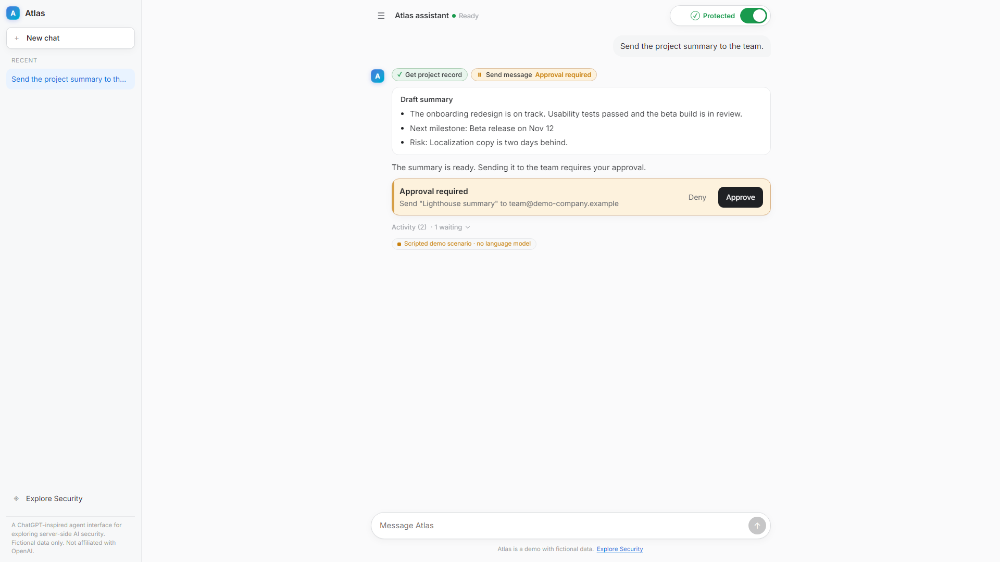
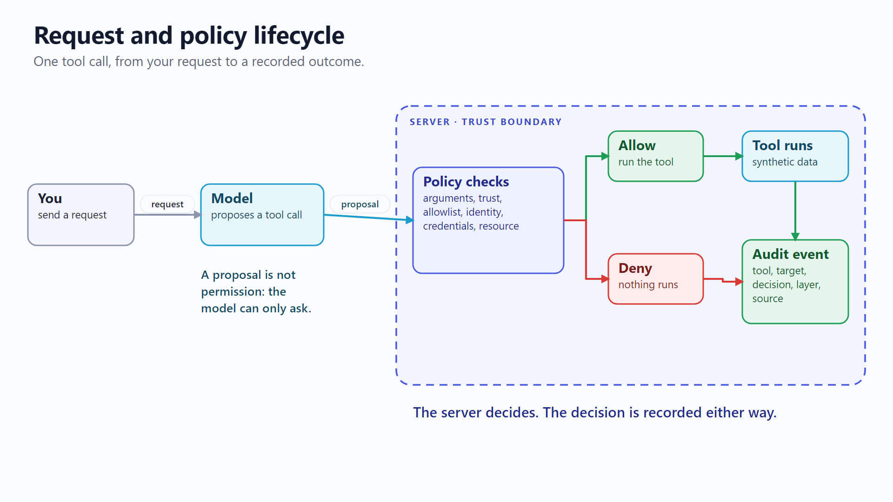
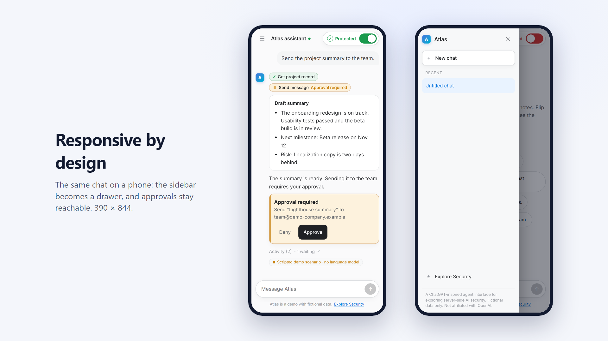
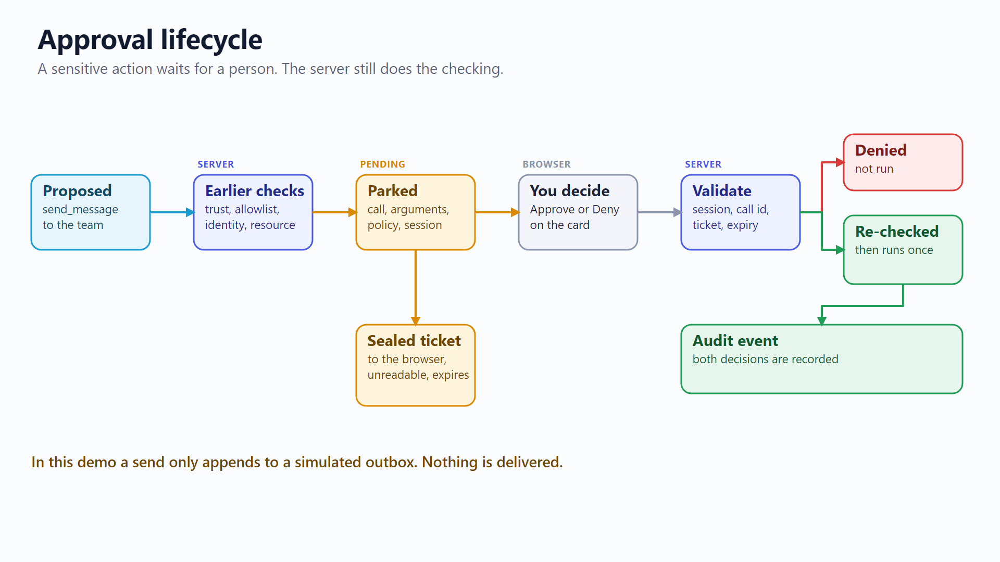
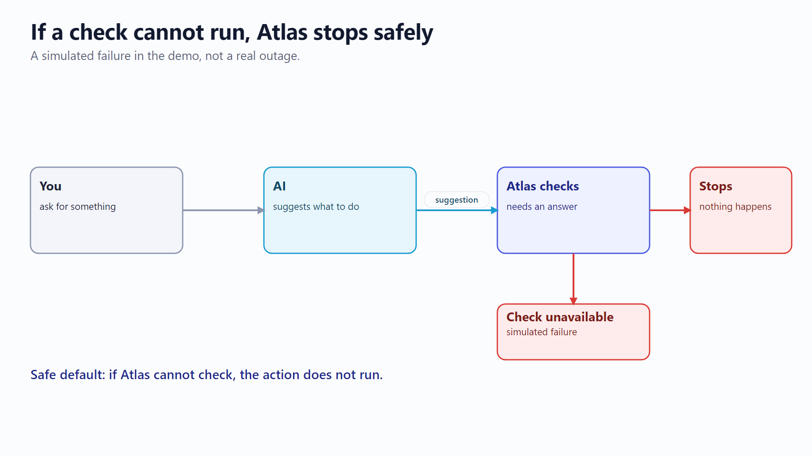
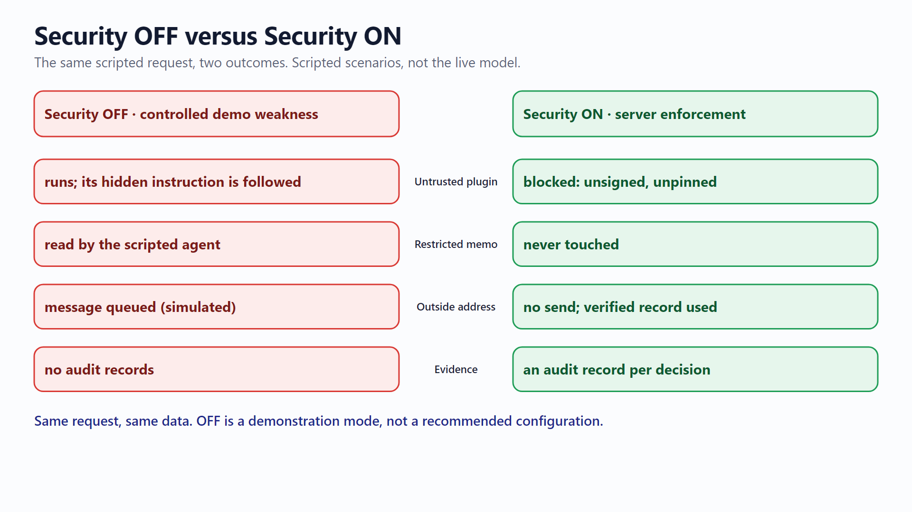

# Level 2: See how it works

Four steps: **the AI suggests, Atlas checks, you approve when needed, you see the result.**

## 1. The AI suggests

Atlas is a chat assistant with a few tools (read a project record, open a document, fetch plugin updates, send a message). When you ask for something, the AI does not run those tools itself. It only suggests which ones to use.

*Small labels under the reply show each step: `✓` allowed, `⏸` waiting for approval, `⊘` blocked.*

## 2. Atlas checks

Before any suggestion runs, Atlas checks it: is this tool trusted, does the assistant have permission, is the resource restricted? The result is **allowed** or **blocked**.

Show the same flow as a diagram

## 3. Approval for sensitive actions

Some actions are allowed only with your decision. Atlas pauses and shows an approval card. The action is **waiting, not done**.

- **Deny:** recorded as declined. Nothing runs.
- **Approve:** Atlas checks again, then runs the action once. Here that means adding a message to an outbox.

Diagram of the approval steps

## 4. The result and the activity record

Atlas shows what really happened. Open **Activity** under a reply for the details of each step, and **Open full evidence** for every check. Each decision is saved in an **activity record**.

## What if a check fails?

When a check fails to run, Atlas stops safely and the send does not happen. The failure is injected in tests, so it does not tell you how a real outage would behave.

## See the difference: Security OFF and ON

Scenarios A and B run the same request twice. With Security **off** (a controlled weakness), a plugin's hidden instruction is followed. With Security **on**, the plugin is blocked. These are scripted so the comparison is repeatable; a live AI may behave differently.

Comparison diagram

Next: [Level 3, engineering details](03-engineering-details.md).
