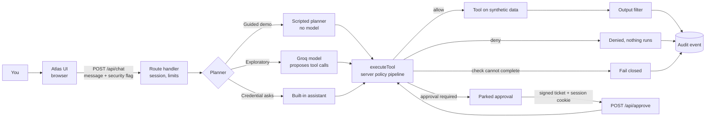

# Architecture

Atlas is a chat assistant whose tool use is decided by the server. The model proposes; the server authorizes.
Everything here describes code in this repository. File names are relative to the repo root.

## Request path

1. **Browser** (`src/components/chat/ChatApp.tsx`) sends `{message, security, history}` to `POST /api/chat`. The `security` flag is a demo setting, not authentication.
2. **Route** (`src/app/api/chat/route.ts`): validates the body (`src/lib/agent/request.ts`), caps its size, mints or reads the anonymous `atlas_sid` cookie (`session.ts`), applies per-session, per-IP and global limits and a concurrent-stream cap, and derives the policy from the boolean only.
3. **Who proposes tool calls** is labelled on every reply:
   - *Scripted demo scenario*: deterministic planner (`planner.ts`), no model, used by stages A to D.
   - *Live model*: Groq through the Vercel AI SDK (`orchestrator.ts`, `provider.ts`). The model only proposes tool calls. No provider fallback exists; failures surface as honest errors.
   - *Built-in assistant*: deterministic answers, used for credential or configuration questions so a model never sees them.
4. **Policy engine** (`executeTool` in `runtime.ts`, profiles in `policy.ts`): every call, from any planner, passes one function: strict argument and resource-kind check, trust and provenance, tool allowlist, identity scope, credential scope and expiry, resource audience, approval gate, execution, output filtering, audit. Each control records a `ControlEval` (decision, reason code, evidence, effect).
5. **Approvals** (`approvals.ts`, `approve.ts`, `seal.ts`): a sensitive call is parked with its exact tool, arguments, policy and session. The browser receives a signed, encrypted **ticket**. `POST /api/approve` needs the same session cookie and a valid ticket, is single use per server instance, expires after 10 minutes, and re-runs the call through the full pipeline.
6. **Audit** (`audit.ts`): one record per decision with `source` of scripted, builtin or model. The UI and walkthrough are built from recorded events only (`walkthrough-model.ts`).

## What the UI shows

| Surface | Source of truth |
|---|---|
| Tool status chips (✓ allowed, ⏸ approval required, ⊘ denied or blocked, ! unavailable) | the `tool` event's `status` and `decision` |
| Activity (collapsed) and its timeline | the same events; details show tool, server decision, reason and outcome |
| Approval card | a parked approval; after the decision, the confirmed result from the server |
| Evidence drawer | per-control evaluations and linked audit records |
| Explore Security: scenarios A to D | real server runs in demo mode |
| Explore Security: architecture path | derived from the selected run's recorded events; unvisited nodes stay gray |
| Guided tour | highlights elements that exist right now; steps without a target are skipped |

## Serverless behaviour

The production deployment is on Vercel. Requests may land on different instances, so approvals travel as sealed tickets (AES-256-GCM, secret in `ATLAS_SEAL_SECRET`). Single use, audit buffers and rate limits are still per instance; see [SECURITY.md](SECURITY.md) and [DEPLOY.md](DEPLOY.md).

## Stack

Next.js 16 (App Router, route handlers), React 19, TypeScript, Vercel AI SDK 7 with the Groq endpoint, OpenUI for model-authored reply components, zod 4 for argument schemas, vitest 3 with jsdom and Testing Library. No database.
